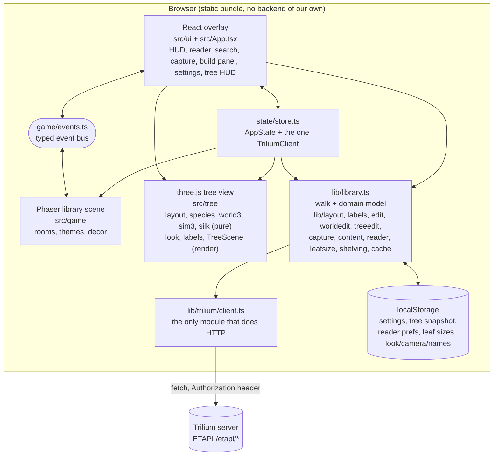

# Architecture

Trilium has no plugin SDK (no manifest, no registry, no extension API; the Script API is
experimental). So Bibliotheca is **not** a Trilium extension. It is a separate, static web app that
talks to Trilium's documented ETAPI REST API straight from the browser. A widget wrapper that
loads the built bundle inside Trilium is a possible later, thin layer *(planned, not started)*.
See [Decisions](Decisions.md) for the reasoning.

## The layers

Read the arrows as "knows about". The rules that hold the picture together:

1. **`src/lib/trilium/`** is the only place that speaks HTTP: `client.ts` (one `TriliumClient`, a
   `TriliumApiError` that collapses network/CORS failures into status 0 "unreachable") and
   `types.ts` (wire shapes copied from the OpenAPI spec). Nothing else may call `fetch` against Trilium
   or know URL shapes. Known exceptions: `ui/SettingsModal.tsx` builds throw-away clients to test credentials,
   and the test tools in `tools/` talk raw HTTP on purpose.
2. **`src/lib/library.ts`** maps the wire shape to the app's own domain model (`src/types.ts`: `NoteInfo`,
   `LibraryTree`, `RoomContents`, ...). That mapping happens once. Swapping the backend would mean rewriting the client and this
   one mapper, not the game or the UI. This is the "portability discipline" from the original architecture notes.
3. **`src/game/`** (Phaser) builds **one room at a time, fresh on every entry**, from `buildRoomContents(tree, roomId)`.
   Nothing about a room is stored, so the world cannot drift from the vault. The scene never talks to Trilium.
4. **`src/tree/`** (three.js) has a pure half and a rendering half. `world3.ts` (branches as 3D rails),
   `sim3.ts` (animals: walking, aiming, flight, reach, silk dangling), `silk.ts` (spider threads as real branches, module-level store until reload),
   `layout.ts` (vault to a forest of branches and leaves, with calculated / effective properties per branch), `species.ts` (the 13 tree kinds as plain data) and `leafkind.ts` import no three.js and no DOM, and are
   unit-tested in Node. `look.ts`, `labels.ts` and `TreeScene.ts` render (bark and leaf colours come from the species through `Branch.species`). The two looks (voxel, low-poly) are built from the same data, so switching
   rebuilds meshes only; the simulation never notices.
   **Editing branches** crosses the boundary on purpose and only in `src/ui` and `src/lib`: `ui/BranchPanel.tsx` (the panel, key `B`) keeps pending edits, `ui/TreeView.tsx` re-runs `layoutTree(tree, { overrides })` for a live preview and swaps the scene's world in place,
   and `lib/treeedit.ts` plans (`planChanges`, `recalcAll`, pure) and writes (`saveChanges`) one label per property through `commitLabel`. The scene itself never talks to Trilium.
5. **`src/ui/`** (React) is the overlay and the coordinator; `src/App.tsx` owns the connection lifecycle and which dialog is open.
6. **The scene imports nothing from React.** React only starts the game (`startGame`) and reuses the pure helpers `game/themes.ts` and `game/decor.ts`; everything else
   crosses the typed event bus in `game/events.ts` (`scene:*` and `build:preview` flow React to Phaser;
   `hud:state`, `book:open`, `layout:move`, `notice`, `focus:note`, `build:slots` flow Phaser to React).
   Handlers that call into the scene are registered **once at module level** and forward to `BibliothecaScene.current`; never register
   bus handlers inside `create()` (see [Troubleshooting](Troubleshooting.md), `StaticGroup.clear` crash).

## Boot and data flow

1. `main.tsx` mounts React. `App` starts Phaser (a waiting screen until world data arrives) and loads settings from localStorage.
   No settings: the settings dialog opens.
2. `refresh()`: `GET /app-info` (validates token and reachability), then `walkLibraryTree(client, rootNoteId)` (below), then
   `computePlacements` for room grid cells, then `saveTreeCache`, then `setState` and `bus.emit("scene:load-world", ...)`.
3. On `unreachable` the app builds the world from the cached snapshot and shows "offline - cached". On `401` it shows an error toast asking you to check the settings (the dialog does not open by itself). The tree snapshot is a
   **fallback**, not a "show cache first" step: the world appears after the walk finishes, or from the cache if the walk failed.
4. The same `LibraryTree` feeds both views. `T` toggles `view` in `App`; the tree view pauses the Phaser scene.

### The walk

ETAPI has no "get subtree", so `walkLibraryTree` is a breadth-first walk of `GET /notes/{id}` (which returns attributes and `childNoteIds` in tree order).
Eight requests are in flight at once. Caps from `config.TREE_WALK`: **400 notes** and **depth 8** (the node cap is checked per batch of 8, so the count lands
in 400 to 407). Beyond the node cap notes are absent; a note at depth 8 is kept but its children are not fetched. Either cut sets `tree.truncated` and
shows the toast "Vault larger than the walk cap - showing the first rooms only." (The comment in older code about "fetched on demand when entered" was never implemented.)
A note that fails to load is skipped; a 401 aborts the walk. Trilium's internal `_hidden` subtree is skipped. Clones: every parent-to-clone edge is recorded, the note is fetched once.

## State

`state/store.ts` is a tiny hand-rolled observable (`useSyncExternalStore`), no Redux. `AppState` = `settings`, `conn`
(`disconnected | connecting | online | offline | error`), `tree`, `placements`, `rootNoteId`, `path`, `overview`, `roomCount`, `notice`.
It also holds the one shared `TriliumClient` (`getClient()`, rebuilt after settings change via `resetClient()`), so there is exactly one place where the base URL is real.

## Labels are the save file

There is no database and no sidecar file. Everything the app wants to remember **about the vault** is a `biblio_*` label on the relevant note:
room grid position, themes, decor, the inbox marker, and the tree's per-branch properties (species, length, thickness, taper, spin, pitch, attach, bend; a pinned leaf spot). Labels travel with the note (renames and moves keep them) and sync with whatever already syncs Trilium.
The full list, formats and who writes each is in [Trilium Mapping](Trilium-Mapping.md). Device preferences (look, camera, reader font) are **not** vault data and
stay in localStorage.

- **Write path for look labels:** only `lib/labels.ts#setLabel` (refuses any name not starting with `biblio_`, re-fetches the note, edits own labels only,
  optional `expectedBefore` check), reached through `lib/worldedit.ts#commitLabel` (patches the in-memory tree and the cache, journals an undo entry, asks the scene to redraw).
  Room positions go through `setLabel` too (`lib/layout.ts#saveRoomPosition`), and so do the tree's branch properties (`lib/treeedit.ts#saveChanges`, one undoable `commitLabel` per label, conflict-checked against the cached value). The one other write is quick capture, which creates notes and the `biblio_inbox` marker.
- **Calculated versus override:** the tree layout computes every property itself; a label is only an *override* and exists only while it differs from the calculated value. Removing it is "recalculate". See [Decisions](Decisions.md#branch-properties-are-labels-with-a-calculated-default).
- **Undo journal** (`lib/edit.ts`): session-only, 50 deep, serialised, conflict-checked. See [Build Mode](Build-Mode.md).
- **Preview never writes:** `build:preview` overrides labels while the room is drawn; the branch panel previews pending edits by laying the tree out with explicit overrides.

## Caching

| What | Where | Key | Notes |
|---|---|---|---|
| Settings (incl. the ETAPI token) | localStorage | `biblio.v1.settings` | Deliberate v1 trade-off, see [Decisions](Decisions.md) |
| Tree snapshot | localStorage | `biblio.v2.treeCache` | Titles, types, own labels only; never content. Written after every successful walk and after label edits. Used only when the server is unreachable. `v2` = own labels only (an old v1 cache cannot render stale looks) |
| Reader preferences | localStorage | `biblio.v1.reader` | `sanitizePrefs` repairs bad values |
| Leaf sizes | localStorage | `bibliotheca.leafsizes.v1` | noteId to `{blob, len}` (numbers only), invalidated by `blobId`, max 5000 entries |
| Tree look / camera / names | localStorage | `biblio.v1.treeLook`, `biblio.v1.treeCam`, `biblio.v1.treeLabels` | Defaults voxel, chase, signs |
| Room description excerpts | memory | - | Cleared whenever the tree is re-walked |
| Note content | **nowhere** | - | Fetched on open, never stored |

## Rendering notes

- **Library:** Phaser 3, fixed 480x270 logical resolution, `pixelArt`, `Phaser.Scale.FIT`. All art is drawn in code at boot and registered under stable asset keys
  (`ASSET_KEYS`), so the repository ships zero binary assets. A texture-pack loader (PNG plus manifest) is *planned*, not built; there is exactly one built-in pack.
- **Canvas fallback gotcha:** headless or GPU-less browsers make Phaser fall back to the Canvas renderer, which ignores `setTint`, so theme washes are translucent colour rectangles.
- **Tree:** three.js, `three` is a dependency whose chunk loads with the tree view and `lizard3d.html`. `window.__treeScene` is a debug handle used by the browser test and `tools/tree-shots.js`. Note content kinds: `lib/content.ts#effectiveType` (and the same rule in `library.ts#toNoteInfo`) treats a `code` note with a markdown mime as `markdown`.
- **Silk threads and the tree world:** a thread is a `Branch` with `silk: true`; `applySilks(world)` re-creates the stored threads whenever the world is rebuilt (an edit, a refresh), so they follow the tree until the page reloads.
- **Build output:** `vite build` has two inputs, `index.html` (the app) and `lizard3d.html` (the standalone tree prototype, no Trilium).

## Portability discipline in practice

- Wire types live in `lib/trilium/types.ts`. The scene and the views use the domain types from `src/types.ts`; the one wire type that leaks into the UI is `EtapiNote` in `ui/BookPopup.tsx` (a metadata fallback).
- Anything Trilium-quirky (own versus inherited labels, name normalisation, `_hidden`) is handled in `library.ts`/`labels.ts` with a comment saying why.
- The ETAPI contract the code relies on is recorded in `AGENTS.md` ("Verified ETAPI contract") and asserted by `tools/etapi-probe.sh`.

Next: [Trilium Mapping](Trilium-Mapping.md), [Decisions](Decisions.md).
